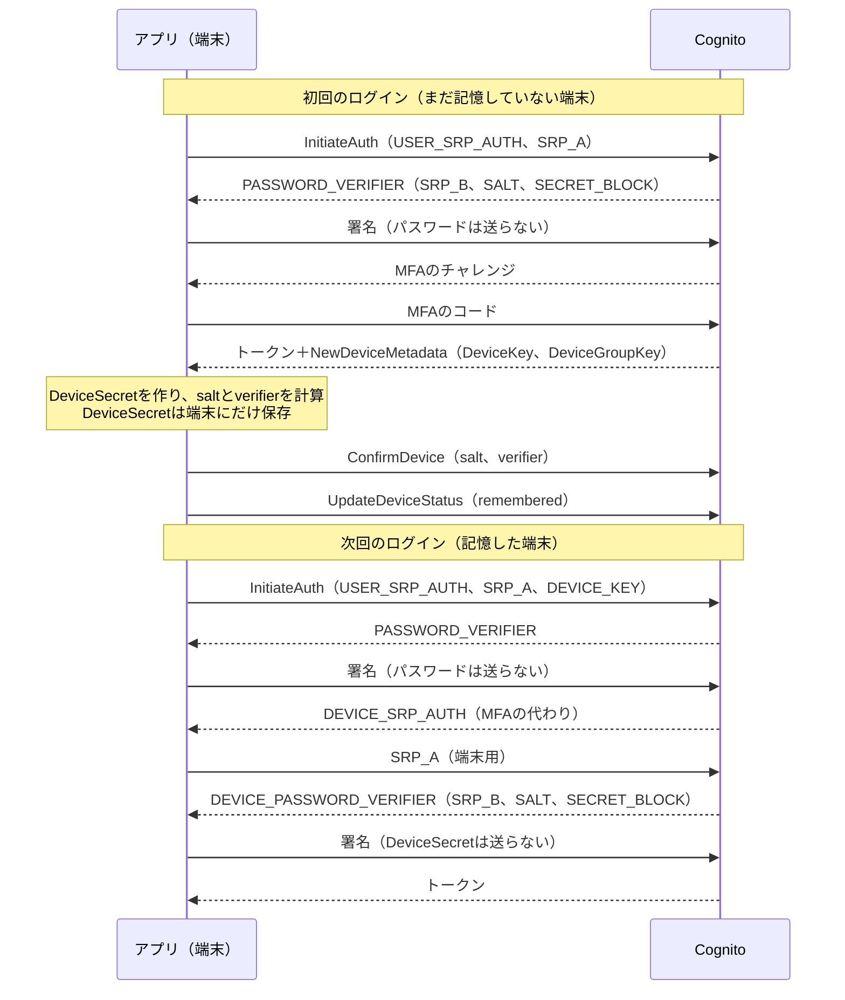

## はじめに

業務でAmazon Cognitoを使ったログインを作っていて、二段階認証（MFA）を一度通した端末を記憶させて、次からはMFAを省けるようにしたいという話がありました。

調べてみると、この「端末の記憶」にはSRP（Secure Remote Password）という仕組みが使われていました。パスワードをサーバーに送らずにログインするための仕組みなのですが、パスワードでよくある「ハッシュ化して突き合わせる」形とはまったく違っていて、初めて見る考え方だったので、概要をつかむのに少し手こずりました。

あとから振り返ると、最初に全体の流れの図があれば早かったなと思ったので、この記事では図を中心にまとめてみます。

:::message
業務のプロダクトの話なので、実装の細かいところは書けません。構成の話にとどめています。
:::

## 普通のパスワード認証との違い

よくあるパスワード認証では、ログインのときにパスワードをサーバーに送って、サーバー側でハッシュ化して、保存してあるハッシュと突き合わせます。通信は暗号化されているとはいえ、パスワードそのものは一度サーバーに届いています。

SRPでは、パスワードを一度も送りません。

・登録のとき：パスワードから計算した「検証用の値（verifier）」と「salt」だけをサーバーに保存する

・ログインのとき：クライアントとサーバーがそれぞれランダムな値を出し合って、お互いに同じ鍵を計算する。パスワードを知っているクライアントだけが、サーバーと同じ鍵を作れる

・最後に：その鍵で作った署名を送って、同じ鍵を作れたこと（＝パスワードを知っていること）だけを示す

サーバーは、パスワードの代わりに「パスワードを知っていれば作れるはずの答え」を確かめている、というイメージです。

## Cognitoの端末の記憶の全体の流れ

Cognitoでは、SRPが2か所で使われていました。1つはユーザーのパスワードでのログイン（`USER_SRP_AUTH`）、もう1つが端末の記憶（`DEVICE_SRP_AUTH`）です。

端末の記憶では、端末ごとにランダムなパスワード（DeviceSecret）を作って、それをSRPのパスワードとして使います。DeviceSecretは端末にだけ保存して、Cognitoにはsaltとverifierしか渡しません。

↓ 初回のログインで端末を登録して、次のログインでMFAの代わりに端末で確かめるまでの流れ



図の中で、特に大事なところです。

・端末の記憶で省けるのはMFAだけで、パスワードでのログインは毎回あります（AWSのドキュメントにも、端末だけでログインすることはできないと書かれていました）

・ConfirmDeviceで登録するのは、パスワードではなくsaltとverifierです

・ユーザーが選んだときだけ記憶する設定（User opt-in）の場合は、ConfirmDeviceのあとにUpdateDeviceStatusで「記憶する」にしないと、次のログインでもMFAが求められます

## なぜパスワードを送らなくても確かめられるのか

ここが、ハッシュを突き合わせる形と一番違うところです。AWSのドキュメントに載っている計算式を、記号を少し省いて書くとこうなります。

↓ 登録のとき（端末側で計算して、vだけをサーバーに渡す）

```
x = H(salt, H(DeviceGroupKey, DeviceKey, ":", DeviceSecret))
v = g^x mod N   ← verifier
```

↓ ログインのとき

```
クライアント：ランダムな a を選び、A = g^a mod N を送る
サーバー    ：ランダムな b を選び、B = (k・v + g^b) mod N を返す
両方        ：u = H(A, B)

クライアント：S = (B − k・g^x)^(a + u・x) mod N
サーバー    ：S = (A・v^u)^b mod N
```

`N` は3072ビットの大きな素数、`g` は2、`H` はSHA-256です。

クライアントとサーバーの式は見た目が全然違いますが、`v = g^x` を入れて整理すると、どちらも `g^(b・(a + u・x)) mod N` になります。

・クライアント側：`B − k・g^x` は `g^b` になるので、`S = (g^b)^(a + u・x)`

・サーバー側：`A・v^u` は `g^a・g^(x・u)` なので、`S = (g^(a + u・x))^b`

クライアントは `x`（＝パスワードから作った値）を知っているので計算でき、サーバーは `v`（verifier）を持っているので計算できます。どちらも相手の秘密（`a` や `b`）は知らないまま、同じ `S` にたどり着きます。この `S` から鍵を作って、鍵で作った署名が一致すれば認証成功、という流れでした。

通信に流れるのは `A`・`B`・salt・署名だけなので、途中でのぞかれてもパスワードは分かりません。また、SRPの仕様（RFC 2945）では、サーバーのverifierが漏れても、パスワードを得るには時間のかかる総当たりが必要になると書かれていました。端末の記憶の場合は、DeviceSecretが長いランダムな文字列なので、総当たりで当てるのはさらに現実的ではなさそうです。

## 動かして確かめる

本当にパスワード（DeviceSecret）を送らずにログインできるのかを、小さなデモで確かめてみました。

・クライアント：Cognitoの公式ライブラリ（amazon-cognito-identity-js 6.3.22）のSRPの計算部分をそのまま使う

・サーバー：saltとverifierだけを持つ、Cognitoの代わりの模擬サーバーを自分で書く

https://github.com/ojagao/zenn-content/tree/main/demos/cognito-device-srp

↓ 実行結果の一部（端末の登録と結果）

```
## 1. 端末の登録（ConfirmDevice）
  端末にだけ保存する DeviceSecret: RSQvz4IVb0Z3W3Dmp/3KERVs…(56文字)
  → サーバーへ ConfirmDevice
    DeviceKey: ap-northeast-1_6db59ab8-…(51文字)
    Salt: AIN2DU+9SbzZP+qfiEK52FU=
    PasswordVerifier: O+jHSXWCB2s+3NC6ns5cq95K…(512文字)

## 結果
  正しい DeviceSecret: 認証成功
  間違った DeviceSecret: 認証失敗
  通信の中に DeviceSecret が含まれていたか: いいえ
```

正しいDeviceSecretでは認証が成功して、間違ったDeviceSecretでは失敗しました。やり取りした値を全部記録して調べても、DeviceSecretは一度も出てきませんでした。乱数を使うので、30回繰り返して全部同じ結果になることも確認しています。

:::message
模擬サーバーは仕組みを確かめるためのもので、本番で使うことは想定していません。
:::

## 実装するときに気をつけたいこと

実際に端末の記憶を組み込んだときに、構成の面で気をつけたことです。

#### ログインもSRP（USER_SRP_AUTH）にする

端末の記憶を有効にすると、`USER_PASSWORD_AUTH`（パスワードをそのまま送るログイン）で手に入れたリフレッシュトークンでは、トークンを更新できませんでした。AWSのトラブルシューティングにも、端末の記憶を使うなら最初のログインは `USER_SRP_AUTH` にする必要があると書かれています。

もともとは端末の記憶のためにSRPを調べ始めたのですが、結果としてログインそのものもSRPに切り替えることになりました。

#### トークンの更新には端末のキーが要る

端末の記憶を有効にしたユーザープールでは、リフレッシュトークンでトークンを更新するときにも `DEVICE_KEY` を付ける必要があります。端末を確認（ConfirmDevice）していないと、`Invalid refresh token` になるそうです。そのため、ユーザーが「記憶しない」を選んだ場合でも、端末の確認だけはしておく形にしました。

#### 端末の情報とトークンは分けて保存する

DeviceKeyやDeviceSecretは、ブラウザを閉じても次のログインで使えるように残しておく必要があります。一方で、トークンはブラウザを閉じたら消えてほしいので、保存する場所を分けました（端末の情報はlocalStorage、トークンはsessionStorage）。

#### 記憶した端末が使えないときは、端末なしでやり直す

管理画面から端末の記憶を消された場合などは、記憶したはずの端末がCognitoに断られます。そのときは手元の記憶を消して、端末なしのログイン（MFAあり）でやり直すようにしました。

## まとめ

SRPは、パスワードを送る代わりに、パスワードを知っていれば作れるはずの鍵を、クライアントとサーバーがそれぞれ計算して確かめ合う仕組みでした。ハッシュを突き合わせる形とは考え方が違うので、最初は概要をつかむのに手こずりました。この記事では、そのとき欲しかった全体の流れの図と、なぜ同じ鍵になるのかをまとめています。

Cognitoで端末の記憶を使うときは、ログインもSRPにすることになるので、同じように調べている人の参考になれば幸いです。

ここまでお読みいただきありがとうございました。

## 参考

https://docs.aws.amazon.com/cognito/latest/developerguide/amazon-cognito-user-pools-device-tracking.html

https://docs.aws.amazon.com/cognito/latest/developerguide/troubleshooting.html

https://docs.aws.amazon.com/cognito/latest/developerguide/amazon-cognito-user-pools-using-the-refresh-token.html

https://datatracker.ietf.org/doc/html/rfc2945
